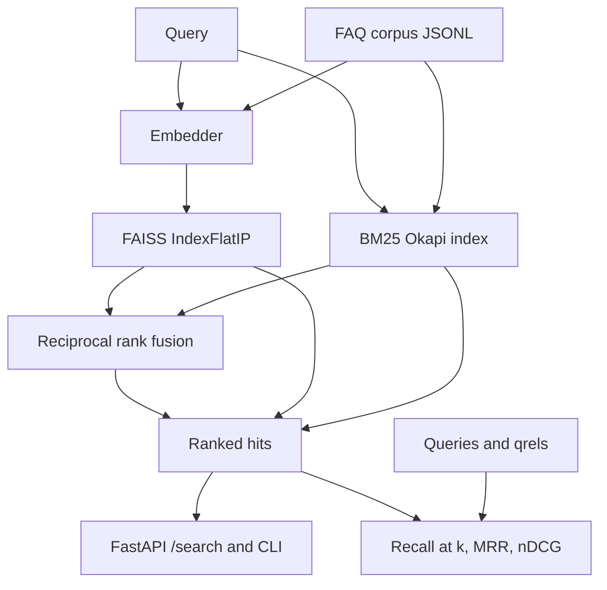

# Semantic search over a technical FAQ

Portfolio project by **Alexandru Cojocari** (junior AI/ML). It retrieves answers from a small FAQ that was written for this repository. Three rankers share that collection: Okapi BM25, dense retrieval with FAISS, and reciprocal rank fusion of the two.

[](https://github.com/DatadrivenAlex/semantic-search-embeddings/actions/workflows/ci.yml)

The default embedder is a deterministic feature hash. Tests and CI never download a model. `all-MiniLM-L6-v2` is an optional path behind the same interface.

## Architecture



Indexing encodes every article once. A query is scored by BM25, by inner product against the FAISS index, or by fusing those two rankings. Evaluation replays the labeled queries and macro-averages the metrics.

## Quickstart

Python 3.11 or newer.

```bash
python -m pip install -e ".[dev]"
python -m pytest
python -m semsearch search "How do I reset my SSO password?" --method hybrid --k 3
python -m semsearch eval --k 10 --embedder hashing
python -m uvicorn semsearch.api:app --host 127.0.0.1 --port 8000
```

`make test`, `make eval`, and `make serve` wrap the same commands.

The search CLI prints the embedder name, the method, and the top document ids. For the query above, BM25's first hit on the bundled FAQ is `faq-sso-reset`. The API returns the same ranking:

```bash
curl -s "http://127.0.0.1:8000/search?q=How%20do%20I%20reset%20my%20SSO%20password%3F&method=bm25&k=2"
```

## Data

| File | Contents |
| --- | --- |
| `data/corpus.jsonl` | 40 FAQ articles (`id`, `title`, `text`) about an internal ML platform |
| `data/queries.jsonl` | 20 questions |
| `data/qrels.jsonl` | 41 graded pairs. `2` is the article that answers the question, `1` is a useful neighbor |

The articles, questions, and grades were written for this repo. They are not a production query log and they were not scraped.

Both rankers index `title` and `text`. Tokens are lowercase alphanumeric runs. There is no stemmer. The stopword list in `semsearch.tokenize` drops closed-class words and the question words that open almost every query (`how`, `what`, `where`, and so on).

## Retrieval methods

**BM25.** [rank-bm25](https://github.com/dorianbrown/rank_bm25) Okapi BM25 with `k1=1.5` and `b=0.75`. Ties break by document id.

**Dense.** The embedder maps text to an L2-normalized vector. FAISS `IndexFlatIP` returns the highest inner products, which equal cosine similarity for normalized vectors. The collection is small, so the index is exact and every document is scored.

**Hybrid.** Reciprocal rank fusion (Cormack, Clarke, and Buettcher, SIGIR 2009). A document at 1-based rank `r` adds `1 / (60 + r)`. The constant is 60. Raw BM25 scores are never mixed with cosine scores. A duplicate id inside one list keeps its first rank.

### Embedders

| Name | When it is used |
| --- | --- |
| `hashing-md5-v1` | Default. Signed MD5 feature hashing of word unigrams and adjacent bigrams into 384 dimensions. Stable across processes. No download. |
| `all-MiniLM-L6-v2` | Optional. `python -m pip install -e ".[ml]"`, then `--embedder minilm`. The first call downloads the sentence-transformers checkpoint. |

The hashing embedder implements the same `encode()` contract as the neural wrapper: a `float32` matrix of shape `(n, dim)`, one L2-normalized row per text. Tests build `HashingEmbedder` directly. They do not import the checkpoint.

## Evaluation

Metrics are macro-averaged over the 20 queries.

- **Recall@k** is the fraction of documents with grade greater than 0 that appear in the top k.
- **MRR** is the mean of `1 / rank` of the first relevant document. The rank is taken on the full ordering of the 40 articles, not cut at k. A query with no relevant hit would score 0. Every bundled query has at least one positive grade.
- **nDCG@k** uses the grades. The ideal list is the positive grades sorted best first, so a relevant article outside the top k lowers nDCG.

Embedder that produced this table: `hashing-md5-v1` (dimension 384). Command: `python -m semsearch eval --k 10 --embedder hashing`.

Deterministic signed MD5 feature hashing over word unigrams and bigrams, L2-normalized. This is not a neural semantic model and it does not download weights.

| Method | Recall@10 | MRR | nDCG@10 |
| --- | ---: | ---: | ---: |
| bm25 | 0.9500 | 1.0000 | 0.9600 |
| dense | 0.8917 | 0.9667 | 0.8907 |
| hybrid | 0.9500 | 0.9750 | 0.9374 |

The same object is checked in at `evals/hashing_k10.json`. `test_checked_in_hashing_report_matches_fresh_run` recomputes it, and `test_readme_quotes_the_checked_in_run` fails if this table is edited by hand.

On this run BM25 has the highest nDCG@10 and an MRR of 1: every labeled query had a relevant article at rank 1. Dense hashing is behind on all three metrics. Hybrid matches BM25's recall@10 and sits between the two methods on MRR and nDCG. That is what you should expect when the embedder is still a lexical hash and the questions were written with words from the answers. It is not a result for `all-MiniLM-L6-v2`. That model was not executed for this table. Twenty queries from one author are too few for a significance test. The third decimal place is not a product decision.

To score the neural model, install the `ml` extra and run:

```bash
python -m semsearch eval --k 10 --embedder minilm
```

Publish that table only with the numbers that command prints, and name the embedder it prints. Do not reuse the hashing numbers above.

## HTTP API

`GET /health` returns the document count and the active embedder.

`GET /search?q=...&method=hybrid&k=5` and `POST /search` with `{"query": "...", "method": "bm25", "k": 3}` return ranked hits. `method` is `bm25`, `dense`, or `hybrid`. `k` is from 1 to 50. Interactive docs are at `/docs`.

```bash
curl -s -X POST http://127.0.0.1:8000/search \
  -H 'content-type: application/json' \
  -d '{"query":"where do we store production secrets?","method":"bm25","k":2}'
```

`SEMSEARCH_EMBEDDER` selects `hashing` (default) or `minilm`. `SEMSEARCH_DATA_DIR` points at a directory that contains the three JSONL files.

## Fine-tuning

`scripts/finetune.py` builds positive pairs `(query, relevant article)` from the qrels. Grade 0 would be skipped. This corpus has 41 positives.

MultipleNegativesRankingLoss does not need explicit negative rows. Other positives in the batch are the negatives. That assumption is shaky here: the two SSO questions share articles, so a true positive can be used as an in-batch negative.

The dry run only writes pairs. It does not import sentence-transformers.

```bash
python scripts/finetune.py --dry-run --pairs-output outputs/train_pairs.jsonl
python -m pip install -e ".[ml]"
python scripts/finetune.py --epochs 1 --batch-size 16 --output-dir outputs/finetune
python -m semsearch eval --k 10 --embedder minilm --model outputs/finetune
```

One epoch on 41 pairs is a wiring check. It is not a reason to expect a gain over the pretrained MiniLM checkpoint. More epochs will memorize this FAQ.

## Runbook

### Install and test

```bash
python -m pip install -e ".[dev]"
python -m ruff check src tests scripts
python -m ruff format --check src tests scripts
python -m pytest
```

`make test` runs ruff and pytest. CI on GitHub Actions is the same pair of steps on Python 3.12. It installs `.[dev]` only, so the neural weights are not part of the job.

### Evaluate or search

```bash
python -m semsearch eval --k 10 --embedder hashing --output evals/hashing_k10.json
python -m semsearch search "How do I request a GPU for model training?" --method dense --k 5
python -m semsearch search "How do I request a GPU for model training?" --method bm25 --json
```

### API process

```bash
python -m uvicorn semsearch.api:app --host 0.0.0.0 --port 8000
curl -s http://127.0.0.1:8000/health
```

The process builds both indexes at the first request. With the hashing embedder that is a CPU-only scan of 40 articles.

### Docker

The image installs the package, copies `data/`, and starts uvicorn as a non-root user. `SEMSEARCH_EMBEDDER=hashing`, so the container does not download weights when it starts.

```bash
docker build -t semsearch:local .
docker run --rm -p 8000:8000 semsearch:local
```

`docker build --build-arg INSTALL_ML=1` also installs sentence-transformers. The image becomes large because of PyTorch. Set `SEMSEARCH_EMBEDDER=minilm` at runtime only on that image. The first request then downloads the checkpoint unless it is already cached.

### Neural embedder and fine-tuning

See the sections above. A machine without outbound network access should stay on `--embedder hashing`. If Hugging Face is blocked, the minilm path fails at model load. The hashing path does not call it.

### CI

Workflow: `.github/workflows/ci.yml`. It runs on pull requests and on pushes to `main`. Failures are either ruff or pytest. A failure that asks for `all-MiniLM-L6-v2` means a test imported the neural class for real. Tests should only hit the "ml extra is not installed" error, and they force that import error even if the extra happens to be present.

### Troubleshooting

| Symptom | What to do |
| --- | --- |
| `semsearch: command not found` | The console script may be outside `PATH`. Use `python -m semsearch`. |
| `Could not find data/corpus.jsonl` | Run from the repo root, or set `SEMSEARCH_DATA_DIR` to the `data` directory. |
| `ImportError` / `libgomp` while importing faiss | Install `libgomp1`. Use the `faiss-cpu` wheel for your platform. The Dockerfile installs the library. |
| `RuntimeError` mentioning the ml extra | You asked for `minilm` or for training without `pip install -e ".[ml]"`. |
| Hugging Face timeout | Stay on the hashing embedder, or prefetch the model on a network that can reach the hub. |
| HTTP 422 from `/search` | `q` / `query` must be non-empty, `method` must be one of the three names, and `k` must be 1 to 50. |
| Hybrid order looks odd next to BM25 | RRF uses ranks, not raw scores. On 40 documents the fused scores sit close together. Compare `--method bm25` before treating a near-tie as a semantic judgment. |

## Limitations

- The corpus is a 40-article FAQ written for this project, labeled by the same person who wrote the articles. Questions reuse words from the answers, which favors BM25. This is not an estimate of quality on real employee questions.
- `hashing-md5-v1` collides tokens into a fixed vector. It does not know that "passphrase" and "password" are related unless those strings appear. The table in this file is that embedder. It is not a MiniLM result.
- CI does not load `all-MiniLM-L6-v2`. The sentence-transformers path is implemented and covered only by the missing-dependency error. A green CI job does not mean the neural model ran.
- The fine-tuning script is optional and was not used to produce the table. Forty-one pairs, with some queries sharing relevant articles, are a poor MultipleNegativesRankingLoss set. Training can overfit, and an in-batch negative can be a second true answer.
- The tokenizer does not stem. "Redeploying" and "redeploy" do not match. The stopword list is fixed and will drop a content word if one is ever added to it by mistake.
- BM25 has no field weights. The title is just the first line of the indexed text.
- `IndexFlatIP` is exact search. Nothing here demonstrates approximate nearest neighbor search, sharding, or index refresh under writes.
- Fusion uses `k=60` and equal weight for both lists. It is not trained. If both lists bury an article, fusion will not recover it. If BM25 is already right, fusion can move that hit down, which is visible in the MRR gap between `bm25` (1.0000) and `hybrid` (0.9750) in the table above.
- Recall and MRR treat grades 1 and 2 as equally relevant. Only nDCG uses the grade. MRR is not MRR@10.
- The API has no authentication, rate limit, or tenant separation. It is a local demo.
- Dependencies that affect the numbers are pinned (`numpy==1.26.4`, `rank-bm25==0.2.2`, `faiss-cpu==1.15.1`) so the checked-in report stays reproducible. Other versions can change a tie.

## Layout

```
data/                 corpus, queries, qrels
evals/hashing_k10.json
src/semsearch/        library, CLI, FastAPI app
scripts/finetune.py   optional bi-encoder training
tests/                offline pytest suite
Dockerfile
Makefile
.github/workflows/ci.yml
```

## License

MIT. Copyright (c) 2026 Alexandru Cojocari. See [LICENSE](LICENSE).
